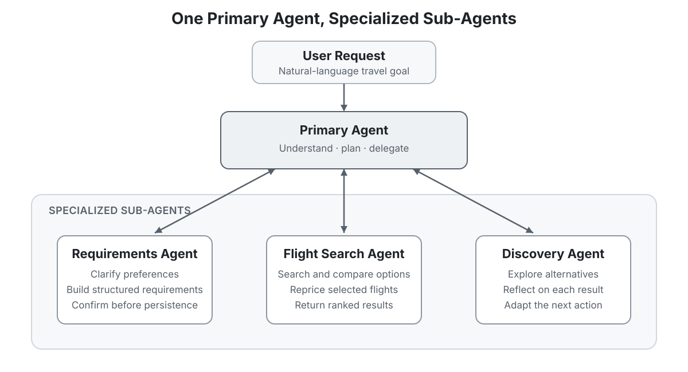

# Travel LLM Agent

> A **Python + LangGraph** project focused on **multi-agent orchestration**, **structured LLM outputs**, and a reflection-driven improvement loop inspired by [Reflexion](https://arxiv.org/abs/2303.11366).

Travel LLM Agent explores how **a team of LLM agents** can turn an **ambiguous travel request into structured requirements, controlled tool execution, and progressively refined actions**.

Built as an independent learning project outside work, it uses flight planning as a concrete domain for studying reusable agent architecture.

## 1. Technical Profile

| Area                   | Technologies and design choices                                                                                                |
| ---------------------- | ------------------------------------------------------------------------------------------------------------------------------ |
| **Orchestration**      | **Python**, **LangGraph**, **LangChain** · `StateGraph`, `Command`, `ToolNode`, checkpoints                                    |
| **Multi-agent design** | **Primary Agent** + **3 sub-agents**: Requirements, Flight Search, and Discovery · typed handoffs · isolated working histories |
| **Structured schemas** | **Pydantic** models · TypedDict state · typed tool contracts · normalized provider data                                        |
| **Reflection loop**    | Attempt snapshots · result evaluation · retained feedback · bounded, feedback-informed actions                                 |
| **Integrations**       | OpenAI · Amadeus APIs · SQLite · optional LangSmith tracing                                                                    |

## 2. Feature Highlights

- **Supervisor–worker delegation:** one Primary Agent owns the conversation and routes bounded tasks to specialized sub-agents.
- **Scoped agent context:** each specialist keeps a separate working history while shared state carries only the information required for handoffs.
- **Reflect → evaluate → adapt:** the Discovery Agent reviews each outcome, retains directional feedback, and uses it to shape the next action.
- **Structured execution:** validated requirements, graph state, handoff payloads, and provider responses remain explicit Python contracts rather than free-form text.
- **Controlled side effects:** live search, repricing, persistence, and approval boundaries remain behind typed tools.

## 3. Architecture: One Primary Agent, Specialized Sub-Agents



The **Primary Agent** owns the user conversation: it interprets the request, chooses the appropriate specialist, and synthesizes the returned result. The three sub-agents own distinct functions—clarifying requirements, searching and repricing flights, and exploring alternatives through reflection—without exposing every implementation detail in the top-level workflow.

Under the hood, the application is a stateful modular monolith. LangGraph coordinates control flow inside one Python process, while typed state separates the supervisor transcript from specialist working histories. External effects remain behind tools: LLM calls go through LangChain, live inventory comes from Amadeus, and durable domain records are stored in SQLite.

## 4. Engineering Focus

### 4.1 LangGraph as an explicit orchestration layer

**Keywords:** `StateGraph` · `Command` · `ToolNode` · conditional edges · reducers · checkpoints

The graph is the application control plane rather than a thin wrapper around a prompt. It defines which agent owns the current task, which state crosses a handoff, where tool calls execute, and how control returns to the supervisor.

- `StateGraph` composes the supervisor and specialist workflows.
- `Command` objects carry both state updates and the next graph destination.
- Custom reducers manage the dialog stack, specialist transcripts, requirement replacement, and discovery snapshots.
- `MemorySaver` and `InMemorySaver` preserve thread-scoped conversational state during execution.
- Explicit step budgets and discovery thresholds keep autonomous loops bounded.

### 4.2 Multi-agent orchestration with scoped context

The system divides the travel workflow by responsibility instead of giving one agent every tool and every message.

| Agent                             | Responsibility                                                                        | Primary contracts                                              |
| --------------------------------- | ------------------------------------------------------------------------------------- | -------------------------------------------------------------- |
| **Primary assistant**             | Interprets requests, selects a specialist, and maintains conversation continuity      | Handoff schemas, dialog stack, passenger/thread configuration  |
| **Requirement elicitation agent** | Converts natural-language preferences into prioritized, validated flight requirements | `FlightRequirements`, granular mutation tools, explicit sync   |
| **Flight search agent**           | Searches, ranks, reprices, and records a user-confirmed selection                     | Amadeus adapter, normalized offers, booking persistence        |
| **Baseline agent**                | Establishes the benchmark filter and offer for autonomous exploration                 | `FDSnapshot`, requirement priorities, baseline evaluation      |
| **Discovery agent**               | Iteratively proposes, executes, reviews, and refines alternative searches             | Session snapshots, reflection comments, success/failure policy |

Each specialist has a dedicated message key such as `flight_search_messages` or `flight_discovery_messages`. This limits prompt growth, prevents one worker's tool transcript from becoming another worker's implicit context, and makes handoff behavior visible in graph state.

### 4.3 A reflection-driven agent improvement loop ([Reflexion](https://arxiv.org/abs/2303.11366))

The autonomous discovery workflow implements a general `observe → evaluate → retain feedback → adapt` pattern:

```text
Establish a baseline
  → propose a bounded change
  → execute the action through a tool
  → compare the result with the baseline
  → write a reflection and directional guidance
  → retain the snapshot in session state
  → use previous reflections to shape the next action
```

Flight discovery is the concrete implementation, but the orchestration pattern is domain-independent. Each attempt records the applied filter, altered values, normalized results, outcome, and reflection comment. The next model turn receives the accumulated session context and is instructed to make progressively informed changes rather than repeat blind trials.

The loop terminates deterministically after either three successful improvements or six unsuccessful attempts. This is agent-level behavioral refinement through feedback and state—not model-weight training or autonomous code modification.

### 4.4 Structured state and tool contracts

The project uses structured output as an application boundary rather than relying on free-form model text:

- **Pydantic domain models** validate priority-based airport, time-window, and budget requirements.
- **Normalized offer models** convert provider JSON into stable flight, segment, fare, schedule, stop, and price fields.
- **TypedDict graph state** defines supervisor state, worker transcripts, discovery sessions, and attempt snapshots.
- **Pydantic handoff schemas** constrain the arguments used when the supervisor delegates work.
- **Typed tools** keep SQL, provider calls, and state mutations in Python while the model supplies validated intent and parameters.

This is schema-driven structured state and tool calling; it does not depend on a provider-specific Structured Outputs API.

## 5. Representative Control Flow

1. The supervisor loads passenger-scoped requirements and decides which specialist should own the request.
2. The requirement agent builds or updates a validated `FlightRequirements` aggregate and synchronizes it explicitly to SQLite.
3. The search agent converts those requirements into Amadeus queries, normalizes and ranks the returned offers, then reprices a selected option before recording a confirmation.
4. For autonomous discovery, the baseline agent selects a benchmark and hands the session to the reflection-driven loop.
5. Completed attempts and their outcomes are persisted together, and a structured handoff returns control to the primary assistant.

The repository also contains taxi and legacy booked-flight tools as examples of extending the same supervisor/specialist pattern to additional travel operations.

## 6. Code Map

```text
main.py                         Terminal entry point

travel_llm_agent/
├── orchestration/              Supervisor graph, shared state, routing, and handoffs
├── agents/
│   ├── requirements/           Requirement elicitation and validated schemas
│   ├── flight_search/          Interactive search, repricing, and booking
│   ├── discovery/              Baseline and reflection-driven exploration
│   ├── taxi/                   Taxi-management extension
│   └── booked_flights/         Legacy booked-flight extension
├── integrations/               Amadeus API adapter
├── domain/                     Normalized flight-offer models
├── persistence/                SQLite configuration and helpers
├── shared/                     Console and reusable graph utilities
└── legacy/                     Earlier orchestration experiments

examples/                       Standalone supervisor example
scripts/                        Database preparation utilities
docs/                           Guides, API examples, architecture assets, and specs
```

## 7. Running the Learning Prototype

### 7.1 Prerequisites

- Python with the dependencies pinned in `requirements.txt`
- `OPENAI_API_KEY`
- Either an Amadeus bearer token or Amadeus client credentials
- A compatible local `llm-agent-db.db` containing the travel and application tables used by the tools

### 7.2 Install and start

```bash
git clone https://github.com/Matt1204/travel-llm-agent.git
cd travel-llm-agent

python -m venv .venv
source .venv/bin/activate
pip install -r requirements.txt

export OPENAI_API_KEY="..."
export AMADEUS_CLIENT_ID="..."
export AMADEUS_CLIENT_SECRET="..."

python main.py
```

`main.py` starts the terminal runner with a thread-scoped LangGraph configuration. The active passenger identifier and recursion limit are visible in the runner and can be adjusted for a compatible local dataset.

## 8. Learning Context

Travel LLM Agent was built outside work to study Python agent engineering at a point when LangChain and LangGraph were becoming the primary tools for explicit stateful orchestration. The project focuses on the transferable mechanics behind multi-agent systems: typed state, delegation, tool boundaries, feedback loops, persistence, and controlled side effects.
